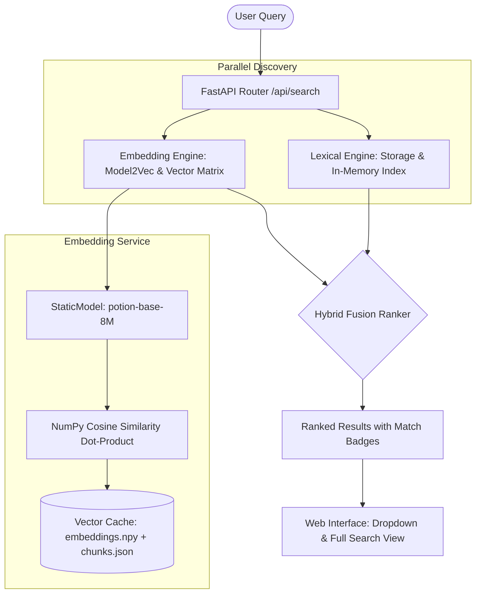

---
categories:
- system-architecture
- user-manual
created: '2026-10-17T02:40:00+00:00'
id: embedding-search
modified: '2026-10-17T02:40:00+00:00'
tags:
- search
- embeddings
- model2vec
- vector
- architecture
- hybrid-search
title: Embedding Search & Hybrid Retrieval Architecture
type: leaf
---

# Embedding Search & Hybrid Retrieval Architecture

WikiKnowledge includes an optional, high-performance semantic search engine powered by static vector embeddings. While traditional wiki searches rely strictly on substring matching across titles and content, Embedding Search enables conceptual discovery—allowing users to find relevant articles even when their search query does not match exact keywords.



---

## 1. Design Principles & Technology Selection

### Why Model2Vec?
Traditional transformer embedding models (like `all-MiniLM-L6-v2` or `BGE`) often require PyTorch or ONNX runtimes, weighing 150MB–500MB, consuming significant RAM, and introducing tens of milliseconds of CPU latency per query.

WikiKnowledge uses **Model2Vec** (`minishlab/potion-base-8M`):
- **Ultra-lightweight**: The model file is only ~8MB on disk.
- **Pure NumPy Inference**: Requires no heavy deep learning frameworks (no PyTorch, no ONNX, no CUDA).
- **Sub-millisecond Latency**: Encodes queries and chunks in under 1ms on a single CPU core.
- **256 Embedding Dimensions**: Provides dense, high-accuracy semantic representations optimized for English prose and documentation.

### Boundary: Reachable Content Only
To prevent index bloat and keep search results strictly relevant to curated knowledge, the embedding engine indexes **reachable wiki content only**:
- **Native Articles & Categories**: All Markdown documents in `knowledge/articles/` and `knowledge/categories/`.
- **Virtual Articles**: Architectural docstrings extracted by [[source-code-plugin|Source Code Plugin]] and synchronized Google Docs from [[google-drive-plugin|Google Drive Plugin]].
- **Explicitly Excluded**: Raw unannotated source code, unit tests, build output, binaries, and gitignored files are never embedded.

---

## 2. Indexing Lifecycle & Chunking Strategy

### Non-blocking Background Indexing
Embedding operations must never block the FastAPI event loop or delay HTTP requests. 
- When enabled via settings, index construction is triggered as a background task.
- Heavy tokenization, Model2Vec inference, and file I/O run inside worker threads via `asyncio.to_thread`.
- An `asyncio.Lock` prevents duplicate or concurrent index builds.
- Status transitions through `idle` → `indexing` → `ready` (or `error`).

### Semantic Chunking
Articles are chunked to allow fine-grained semantic matches without losing parent context:
1. **Overview Chunk**: Combines the article title, ID, tags, and categories.
2. **Heading Sections**: Content is split by Markdown headings (`#`, `##`, `###`).
3. **Paragraph Sub-chunking**: Large sections (>600 characters) are partitioned at paragraph boundaries (`\n\n`), prepending the article title and heading to each chunk so isolated text retains semantic context.
4. **Sanitization**: Internal comment markers such as `<!-- human:start -->` and `<!-- ai:start -->` are stripped before embedding.

### Unit Vector Normalization
All chunk embeddings are normalized to unit length ($L_2$ norm = 1.0) and stored as `float32`. This reduces cosine similarity computation to a single vectorized matrix dot product:
$$\text{similarity}(q, c) = \mathbf{q}_{\text{norm}} \cdot \mathbf{M}^T$$

---

## 3. Persistent Disk Cache

To ensure instant server startup, computed vectors and chunk metadata are cached on disk:

```
knowledge/
├── .index/
│   └── embeddings/
│       ├── embeddings.npy    # Normalized float32 embedding matrix
│       ├── chunks.json       # Chunk text, article IDs, and headings
│       └── meta.json         # Indexing timestamp and counts
```

- When the server starts with embedding search enabled, the pre-computed cache loads in **~3 milliseconds**.
- If the cache does not exist, the server schedules a background build without delaying startup.
- `knowledge/.index/` is ignored by Git, ensuring local vectors remain machine-portable.

---

## 4. Hybrid Ranking Algorithm

When a user submits a query `GET /api/search?q=...`, WikiKnowledge executes both lexical and vector searches, merging them with a composite score:

| Match Category | Composite Score Formula | Priority | Badge |
|---|---|---|---|
| **Hybrid Match** | $1.0 + \text{cosine\_similarity}$ | Highest (scores 1.20 – 1.85) | `HYBRID` (Blue) |
| **Exact Lexical Match** | $1.0$ | High (score 1.00) | Native / Default |
| **Pure Semantic Match** | $\text{cosine\_similarity}$ | Conceptual (scores 0.20 – 0.85) | `SEMANTIC` (Purple) |

- **Exact keywords boosted**: Articles that match the user's literal keywords and conceptually align with the query rise to the top.
- **Zero-keyword discovery**: Articles discussing the topic without using the exact keywords are surfaced seamlessly instead of returning "No results".
- If embedding search is disabled, the system gracefully falls back to pure lexical search.

---

## 5. Web UI & Configuration

### Configuration File
Settings are stored in `knowledge/.settings/search_config.json`:
```json
{
  "embedding_search": {
    "enabled": true,
    "model_name": "minishlab/potion-base-8M",
    "min_score": 0.20,
    "top_k": 30
  }
}
```

### Settings UI (`#/settings`)
The System Settings page provides an **Embedding Search (Model2Vec)** card:
- **Toggle Checkbox**: Enables or disables semantic search dynamically.
- **Index Status Badge**: Displays live status (`● READY`, `⏳ INDEXING...`, `DISABLED`, or `ERROR`) along with article and chunk counts.
- **Rebuild Index Button**: Triggers an on-demand background rebuild with real-time polling.

### Search Display Layout
- **Sidebar Dropdown**: Designed with a **title-first layout**. The article title appears prominently on the first line, with type, origin, and semantic match chips located on a secondary row below to ensure article names are never crowded or obscured.
- **Full Search View (`#/search?q=...`)**: Displays full search cards containing the article title, match badge (`HYBRID` or `SEMANTIC`), excerpt snippet highlighting the matching section, and associated tag chips.
