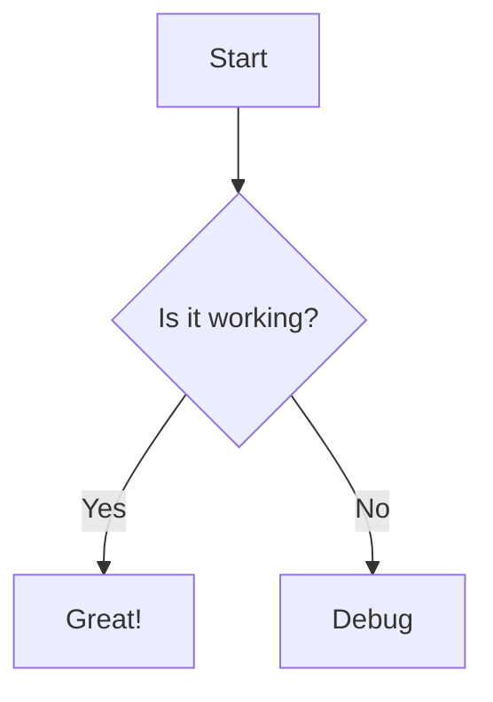
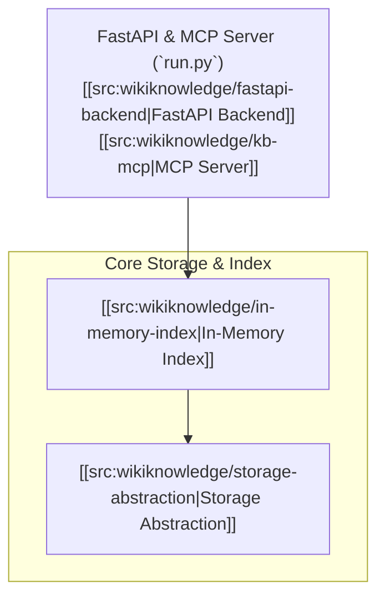

---
categories:
- markup-conventions
created: '2026-06-30T04:23:31.513890+00:00'
id: mermaid-diagrams
modified: '2026-11-08T05:08:32.055683+00:00'
tags:
- markup
- mermaid
- diagrams
- ui
- wiki-links
title: Mermaid Diagrams
type: leaf
---

# Mermaid Diagrams

<!-- human:start -->
WikiKnowledge supports rendering Mermaid diagrams directly from Markdown code blocks with native support for clickable wiki links within diagram nodes.

To embed a diagram in your article, use a standard markdown fenced code block and specify `mermaid` as the language:

The frontend uses `marked.js` and `mermaid.js` to intercept these code blocks and render them interactively within the article viewer and editor preview. This ensures diagrams stay in sync with the document content and are seamlessly rendered without requiring external images.

## Interactive Wiki Links in Diagrams

Diagram nodes can contain `[[wiki-links]]`, enabling architectural visuals and flowcharts to serve as interactive navigation maps:

- **Standard Wiki Links**: `[[article-id]]` or `[[article-id|Display Text]]`
- **Source Code Virtual Articles**: `[[src:source-name/module-path|Display Text]]`
- **Google Drive Documents**: `[[gdrive:doc-id|Display Text]]`
- **Anchor Links**: `[[article-id#section-anchor|Display Text]]`

### Example: Architectural Diagram with Links

### Rendering & Interaction Behavior

1. **Pre-Render Resolution**: Before Mermaid renders the diagram, the viewer resolves `[[...]]` markup into styled anchor elements (`<a class="wiki-link">`).
2. **Visual Indicators**: Links inside diagram nodes retain standard WikiKnowledge styling, including source indicators (e.g. `🔌` for source code, `☁️` for Google Drive) and missing/disconnected states.
3. **SPA Routing**: Clicking a link inside a diagram navigates smoothly to the target article via hash-based routing without reloading the application.
4. **Multiple Links per Node**: A single node label can contain multiple links separated by text or line breaks (` `).
<!-- human:end -->

## Error Handling & Auto-Repair

`Viewer.renderMermaid()` (in `frontend/js/viewer.js`) validates each diagram with `mermaid.parse()` before rendering, picking the first of these variants that parses:

1. **Pseudo-tags escaped** (`escapeMermaidPseudoTags`): text such as `<appId>` or `List<int>` is converted to Mermaid entity codes so it is shown literally instead of being silently stripped as unknown HTML. Formatting tags (`<b>`, ` `, `<i>`, ...), arrows (`<-->`) and stereotypes (`<<interface>>`, `<<choice>>`) are left alone.
2. **Source as written**.
3. **Repaired** (`repairMermaidSource`, flowcharts only): unquoted edge labels and node labels containing parentheses are quoted, e.g. `A -->|Flip (Tap)| B` becomes `A -->|"Flip (Tap)"| B`. This is the most common authoring mistake: Mermaid's grammar rejects bare `(` / `)` in `|edge labels|` and `[node labels]`.

Valid diagrams are never modified by the repair step. Links are resolved to `<a>` / `` markup *before* this chain runs, so every step is written to leave that markup intact: `<a>` and `` are whitelisted tags, and a variant that fails to parse (for example one where escaping broke the quoting around a link's attributes) is skipped in favor of the next candidate. Links work in node labels, edge labels, subgraph titles and non-flowchart diagrams (e.g. sequence participants), in every flavor: `[[id]]`, `[[id|text]]`, `[[id#anchor|text]]`, `[[#same-page-anchor|text]]`, `[[src:...]]`, `[[gdrive:...]]` and `[[file:...]]`. Missing targets are flagged `.missing`; unknown `src:`/`gdrive:` sources render as a non-clickable `.disconnected` span. If no variant parses, the block shows a readable error box (message plus collapsible source) instead of Mermaid's bomb graphic, and other diagrams on the page still render.

See [[math-rendering]] for the frontend test suite that covers this behavior.